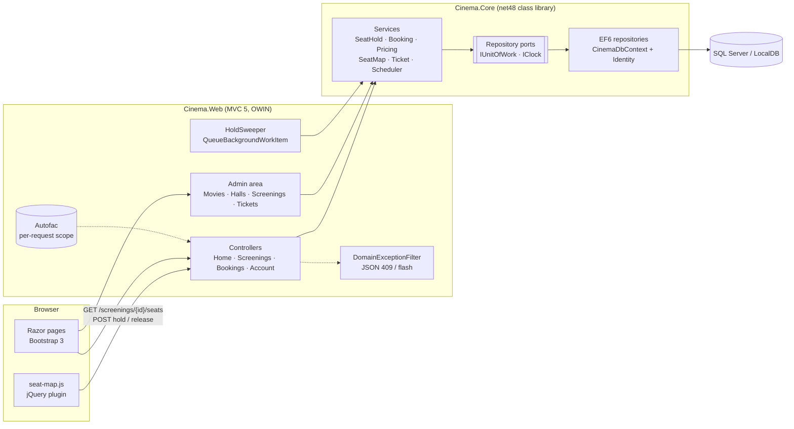
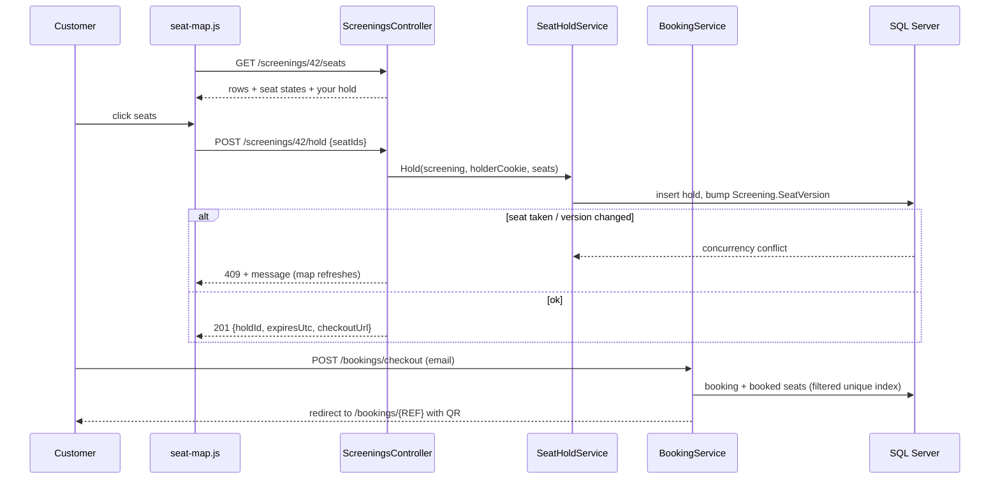

# Lumiere — cinema seat booking on ASP.NET MVC 5

> Pick seats on a live seating plan, hold them for a few minutes while you check out, and walk in with a signed QR e-ticket.

[](https://github.com/alexgeorghiou/cinema-booking-mvc/actions/workflows/ci.yml)
[](LICENSE)


A complete box-office web app built on the classic ASP.NET MVC 5 / .NET Framework 4.8 stack:
EF6 code-first, Razor, ASP.NET Identity over OWIN, Autofac, and a Bootstrap 3 + jQuery seat map.
The business rules live in a framework-free core library with a fast xUnit suite.

## Features

- **What's on** – seven-day listings grouped by film, times shown in the venue's time zone.
- **Interactive seat map** – jQuery plugin rendering standard, premium and wheelchair spaces;
  polls every 15 s so seats taken by other customers disappear while you choose.
- **Seat holds with expiry** – seats are held for a configurable window (8 min default) with a
  live countdown. A new selection replaces your previous hold; expired holds free themselves
  by timestamp and a background sweeper tidies them up.
- **No-orphan-seat rule** – selections that would strand a single empty seat between taken
  seats are rejected (only gaps *you* create, never pre-existing ones).
- **Pricing** – base price × seat multiplier, 3D/IMAX surcharges, weekday matinee discount,
  per-seat booking fee, penny rounding.
- **Booking confirmation** – converts a live hold into a booking with an unambiguous 8-character
  reference (no `0/O/1/I`). Guest checkout with email, or signed-in accounts.
- **E-ticket with QR code** – printable ticket; the QR payload is HMAC-signed so forged or
  edited codes fail at the door before the database is touched.
- **Cancellation window** – signed-in customers can cancel until 60 minutes before the show;
  seats return to sale immediately.
- **Admin area** (`Admin` role) – occupancy dashboard, movies (archive/restore), hall
  generator (rows × seats, premium rows, wheelchair spaces), screening scheduler with
  overlap + cleaning-buffer checks, per-screening booking list, door check-in.

## Architecture



### Booking flow



## Quickstart

Requirements: Windows, Visual Studio 2022 (ASP.NET workload) or Build Tools with web targets,
SQL Server LocalDB.

```powershell
git clone https://github.com/alexgeorghiou/cinema-booking-mvc.git
cd cinema-booking-mvc
nuget restore Cinema.sln
msbuild Cinema.sln /p:Configuration=Debug
# open Cinema.sln and run Cinema.Web on IIS Express (https://localhost:44321)
```

On first request the database `CinemaBooking` is created on `(LocalDb)\MSSQLLocalDB`, migrated
and seeded with three films, two halls and a week of screenings. In Debug an administrator
`admin@cinema.local` / `Admin#2026` is seeded (blanked by `Web.Release.config`).

Run only the core tests (works with the plain .NET SDK, no Visual Studio needed):

```powershell
dotnet test tests/Cinema.Core.Tests
```

### Docker (Windows containers)

```powershell
docker build -t cinema-booking-mvc .
docker run -d -p 8080:80 `
  -e CINEMA_DB="Server=host.docker.internal,1433;Database=CinemaBooking;User Id=sa;Password=<pwd>;TrustServerCertificate=True" `
  cinema-booking-mvc
```

### Configuration (`Web.config` → `appSettings`)

| Key | Default | Meaning |
| --- | --- | --- |
| `Cinema:TimeZoneId` | `GMT Standard Time` | Venue time zone (display + matinee rule) |
| `Cinema:HoldMinutes` | `8` | How long selected seats are held |
| `Cinema:MaxSeatsPerBooking` | `10` | Seat cap per hold |
| `Cinema:EnforceNoSingleSeatGap` | `true` | Reject selections that strand one seat |
| `Cinema:CleaningBufferMinutes` | `20` | Turnaround between screenings in a hall |
| `Cinema:CancellationCutoffMinutes` | `60` | Latest cancellation before start |
| `Cinema:ServiceFeePerSeat` | `0.75` | Booking fee |
| `Cinema:TicketSigningKey` | dev key | HMAC key for QR payloads – **override in production** |

## Project structure

```
Cinema.sln
├── src/
│   ├── Cinema.Core/                 net48 class library (SDK-style project)
│   │   ├── Domain/                  Movie, Hall, Seat, Screening, SeatHold, Booking
│   │   ├── Abstractions/            repository ports, IClock, CinemaOptions, domain exceptions
│   │   ├── Services/                SeatHoldService, SingleSeatGapRule, BookingService,
│   │   │                            PriceCalculator, SeatMapService, TicketService,
│   │   │                            ScreeningScheduler, HallLayoutBuilder
│   │   ├── Data/                    CinemaDbContext (EF6 + Identity), EF repositories, EfUnitOfWork
│   │   ├── Identity/                ApplicationUser, role names
│   │   └── Migrations/              automatic-migrations configuration + idempotent seed
│   └── Cinema.Web/                  classic MVC 5 web application project
│       ├── App_Start/               routes, filters, Autofac, Identity managers, HoldSweeper
│       ├── Controllers/             Home, Screenings (seat map JSON), Bookings, Account
│       ├── Areas/Admin/             Dashboard, Movies, Halls, Screenings, Tickets
│       ├── Infrastructure/          exception filter, holder cookie, AJAX anti-forgery, time helpers
│       ├── Scripts/app/seat-map.js  seat map jQuery plugin
│       └── Views/                   Razor views
└── tests/
    └── Cinema.Core.Tests/           xUnit, in-memory store + fake clock
```

## Design decisions and trade-offs

- **Core is persistence-agnostic.** Services depend on small repository ports and `IClock`, so
  the whole rule set (holds, expiry, gaps, pricing, cancellation, tickets, scheduling) is tested
  in milliseconds against an in-memory store. EF6 lives behind the same ports.
- **Expiry by timestamp, sweeping for hygiene.** A hold counts only while
  `Status == Active && ExpiresUtc > now`, so correctness never depends on a background job. The
  sweeper only marks rows `Expired`.
- **Two layers against double-selling.** Every hold/booking bumps `Screening.SeatVersion`, an
  EF optimistic-concurrency token, so two racing requests for the same screening cannot both
  commit (the loser gets HTTP 409 and refreshes). Sold seats are additionally guarded by a
  filtered unique index `(ScreeningId, SeatId) WHERE IsActive = 1`; EF6 cannot express filters,
  so the seed creates it idempotently. Cancelling flips `IsActive` so history is kept and the
  seat can be resold. The trade-off: holds on *different* seats of one screening also serialize,
  which is acceptable at cinema traffic levels.
- **Holds belong to the browser.** An opaque `cinema.holder` cookie owns the hold, so guests can
  book and a hold survives signing in mid-checkout.
- **Signed QR payloads.** `CNM1.{ref}.{screening}.{seats}.{hmac}` lets the door reject forgeries
  offline; check-in is single-use and limited to an admission window.
- **Automatic migrations.** Keeps the demo self-contained (`F5` and go). A production deployment
  would switch to explicit code-based migrations generated with `Add-Migration`.
- **PackageReference in a classic web project.** `Cinema.Web` is an old-style web application
  csproj (IIS Express, `Web.config` transforms) but restores NuGet packages with
  `PackageReference`, so the dependencies of `Cinema.Core` flow through transitively instead of
  being duplicated in `packages.config`. Front-end libraries come from cdnjs rather than
  content NuGet packages.
- **Payment is out of scope.** Checkout confirms the booking; payment would slot in between
  `Quote` and `Confirm`.

## Testing

`tests/Cinema.Core.Tests` (xUnit, net48) covers hall generation, pricing (surcharges, matinee
window in venue time, rounding), seat map states, hold lifecycle (expiry, replacement, release,
sweeping, concurrency surfacing), the single-seat gap rule, booking confirmation and
cancellation, reference generation, QR signing/verification/check-in and screening scheduling.

## Roadmap

- Payment provider integration with a pending-payment state between hold and confirmation
- Email delivery of the e-ticket (queued, with the QR inline)
- SignalR push instead of polling for seat-map updates
- Explicit EF code-based migrations and a SQL Server integration test job
- Concession add-ons and promo codes

## License

[MIT](LICENSE) © 2026 Alex Georghiou
